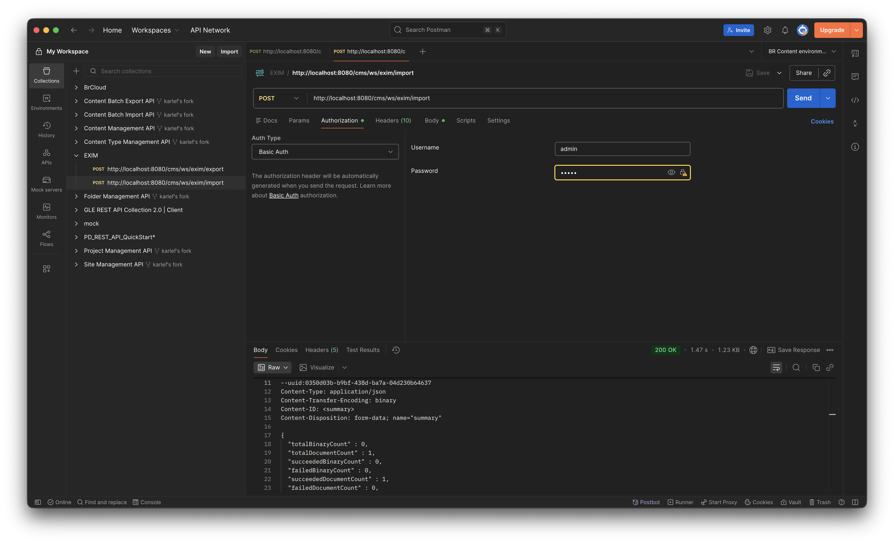
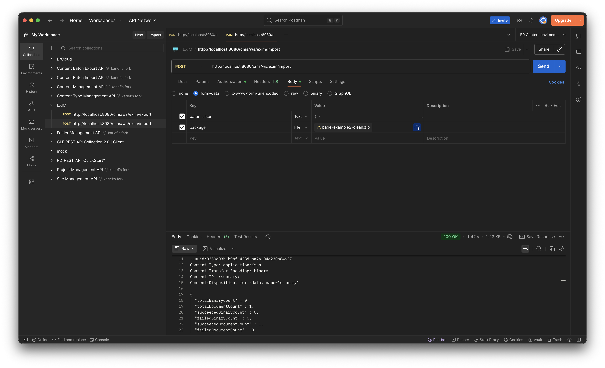

How to transform and batch import pages into the CMS using the Exim API

1. Use the page-example.json as your schema to transform all your current pages
2. Zip all your json files into a single zip file (e.g., pages-clean.zip)
3. Execute the following curl command or use Postman to import the pages into the CMS
```
curl -i -u admin:admin \
-F 'paramsJson={"publishOnImport":"all","batchSize":100,"throttle":10,"documents":{"includes":["/content/documents/channela/pages/**"]}}' \
-F 'package=@/Users/Lef/Desktop/pages-clean.zip' \
http://localhost:8080/cms/ws/exim/import
```


4. After the import is complete, you can verify the imported pages in the CMS and by navigating to http://localhost:3003/channelA/pages